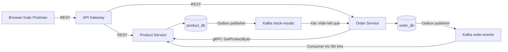

# TX2 E-commerce Microservices

Bài thực hành Java Web gồm cả Câu 1 và Câu 2. Java 17, Spring Boot 3.5.4,
Spring Cloud Gateway 2025.0.0, MySQL 8.0, gRPC và Apache Kafka 3.9.1.

## Cấu trúc

```text
tx2/
├── TX2.pdf
├── baocao.docx
└── code/                     ← chạy các lệnh bên dưới tại đây
    ├── pom.xml               Maven multi-module
    ├── proto/                Contract gRPC dùng chung
    ├── common/               Event DTO, xử lý lỗi, transactional outbox
    ├── api-gateway/          Cổng API và giao diện đặt hàng
    ├── product-service/      REST, gRPC server, Kafka consumer, product_db
    ├── order-service/        REST, gRPC client, Kafka producer, order_db
    ├── database/             SQL khởi tạo và bản sao dữ liệu khi nghiệm thu
    ├── postman/              Collection và môi trường để import vào Postman
    ├── k8s/                  Manifest đầy đủ cho namespace tx2-ecommerce
    ├── scripts/              Build, triển khai, test, tạo báo cáo
    ├── evidence/             Kết quả kiểm thử thực tế
    └── .gitlab-ci.yml        Build → push image → rolling deployment
```

## Chạy bằng Docker Compose

Cần JDK 17, Maven và Docker Desktop đang chạy Linux containers. Không cần
dùng tài khoản MySQL đã cài trên Windows vì bài chạy MySQL riêng trong Docker.

```powershell
cd code
powershell -ExecutionPolicy Bypass -File scripts/start.ps1
```

Mở **http://localhost:18080** để chọn sản phẩm, nhập số lượng và đặt hàng.
Gateway API: **http://localhost:18080/api/products**.

Cách chạy thủ công tương đương:

```powershell
mvn -B clean verify -ntp
docker compose up -d --build --wait --wait-timeout 300
docker compose ps
docker compose logs --tail 100 product-service order-service
```

| Thành phần | Địa chỉ trên máy | Địa chỉ nội bộ Docker |
|---|---|---|
| Gateway | localhost:18080 | api-gateway:8080 |
| Product REST | localhost:8081 | product-service:8081 |
| Product gRPC | localhost:9090 | product-service:9090 |
| Order REST | localhost:8082 | order-service:8082 |
| MySQL | localhost:3310 | mysql-db:3306 |
| Kafka | localhost:29092 | kafka:9092 |

Các cổng công bố chỉ bind vào `127.0.0.1`. Có thể sao chép `.env.example` thành
`.env` để đổi cổng Gateway, MySQL, Kafka và mật khẩu demo. Nếu đổi cổng Gateway,
đổi `baseUrl` trong Postman và tham số `--base-url` của script kiểm thử tương ứng.
Không sửa riêng mật khẩu `.env` sau khi đã tạo volume MySQL; tài khoản trong
database cần được đổi tương ứng.

Tắt ứng dụng, giữ dữ liệu:

```powershell
docker compose stop
```

## Kiến trúc và luồng dữ liệu



1. Order gọi gRPC để lấy thông tin sản phẩm, giá và tồn kho. Sản phẩm không tồn tại
   trả HTTP 404; thiếu tồn kho trả 409; Product không kết nối được trả 503 sau deadline 3 giây.
2. Order lưu đơn `PENDING` và `OrderCreatedEvent` vào outbox trong **cùng transaction MySQL**.
   HTTP 201 thể hiện đơn đã được tiếp nhận; chưa có nghĩa đã giữ được hàng.
3. Publisher gửi outbox đến Kafka. Kafka ngừng hoạt động thì bản ghi được giữ lại
   và gửi lại khi broker phục hồi. Không dùng thao tác ghi kép DB rồi gửi event ngoài transaction.
4. Product khóa dòng sản phẩm, kiểm tra lại tồn kho và trừ kho trong transaction.
   `processed_orders` lưu mã đơn đã xử lý để việc phát lại event không trừ kho lần hai.
   Event cùng sản phẩm dùng cùng Kafka key; row lock vẫn bảo vệ khi có nhiều replica.
5. Product lưu kết quả vào outbox. Order nhận `stock-results` và chuyển sang
   `CONFIRMED` hoặc `REJECTED`. Khi nhiều đơn tranh sản phẩm cuối, số lượng xác nhận
   không vượt tồn kho; đơn chưa được cấp hàng sẽ bị từ chối bất đồng bộ.

Giá dùng `BigDecimal` và cột `DECIMAL`. Proto giữ trường `double price` theo đề,
đồng thời truyền `price_decimal` để Order tính tổng tiền chính xác.
Kafka chạy **KRaft**, không cần ZooKeeper. Đây là cách triển khai broker khác ví dụ
ZooKeeper trong đề, vẫn thực hiện đúng producer, consumer và topic yêu cầu.

## API

Collection Postman là bộ hợp đồng request có assertion chạy được. API demo không
cấu hình đăng nhập. Sản phẩm mẫu được tạo với ID 1, 2, 3 khi Product khởi động.

| Method | Đường dẫn | Kết quả |
|---|---|---|
| GET | `/api/products?page=0&size=50` | Danh sách sản phẩm, tối đa 100 bản ghi/trang |
| GET | `/api/products/{id}` | Sản phẩm hoặc 404 |
| POST | `/api/products` | Tạo sản phẩm, 201 |
| PUT | `/api/products/{id}` | Sửa sản phẩm |
| DELETE | `/api/products/{id}` | Xóa sản phẩm, 204 |
| POST | `/api/orders` | Tiếp nhận đơn, 201 và trạng thái PENDING |
| GET | `/api/orders?page=0&size=50` | Danh sách đơn mới nhất |
| GET | `/api/orders/{id}` | Trạng thái xử lý đơn |
| GET | `/actuator/health` | Sức khỏe của service đang truy cập |

Tạo sản phẩm:

```json
{"name":"Ban phim co","price":850000.00,"stock":20}
```

Tạo đơn:

```json
{"productId":1,"quantity":2}
```

Giới hạn đầu vào: tên 1–150 ký tự không chỉ chứa khoảng trắng; giá > 0, tối đa
10 chữ số nguyên và 2 chữ số thập phân; tồn kho ≥ 0; số lượng đặt 1–10000.

## Kiểm thử

```powershell
mvn -B verify -ntp
postman collection run postman/tx2.postman_collection.json --no-report-events
python scripts/verify-system.py
```

Import `postman/tx2.postman_collection.json` và `postman/local.postman_environment.json`
vào ứng dụng Postman nếu muốn chạy giao diện. Chạy collection theo thứ tự để truyền
`productId`, `orderId` giữa các request. Collection tạo sản phẩm riêng, tạo một đơn,
đợi Kafka xác nhận, kiểm tra tồn kho rồi xóa sản phẩm thử. Đơn thử vẫn được lưu.
Postman CLI chạy local không cần tài khoản; tùy chọn xuất `--output` của CLI hiện
yêu cầu đăng nhập, nên bằng chứng local được lưu bằng log terminal.

Kiểm tra thực tế Kafka mất kết nối, gửi lại event và Product ngừng hoạt động:

```powershell
python scripts/verify-system.py --resilience
```

Lệnh này **tạm dừng rồi khởi động lại Kafka và Product của riêng Compose project
`tx2-ecommerce`**. Không chạy trong lúc demo hoặc chạy collection khác.
Kết quả lưu ở `evidence/system-tests.json`; không dùng mock để thay cho Kafka/MySQL/gRPC.
Các test Java dùng H2 và mock gRPC client để kiểm tra transaction, tiền, idempotency;
bằng chứng tích hợp các dịch vụ thật nằm trong script và Postman.

## Triển khai Minikube

```powershell
powershell -ExecutionPolicy Bypass -File scripts/deploy-minikube.ps1
minikube kubectl -- -n tx2-ecommerce get pods,services,pvc
minikube kubectl -- -n tx2-ecommerce port-forward service/api-gateway 18081:8080
```

Giữ cửa sổ port-forward mở, truy cập **http://localhost:18081**.
Hoặc chạy `powershell -File scripts/open-minikube.ps1` để tạo port-forward nền và
lưu PID cùng log trong `logs/`.
Compose và Kubernetes có dữ liệu riêng. Product chạy 2 replica; `maxSurge: 1`,
`maxUnavailable: 0`, startup/readiness/liveness probes và graceful shutdown giúp
rolling update giữ pod sẵn sàng phục vụ. MySQL và Kafka dùng PVC; bản demo chỉ có
một node database và broker, nên không tuyên bố HA cho hai thành phần này.

Pod có preStop 10 giây để cập nhật endpoint trước khi tắt tiến trình. Gateway thử
lại tối đa 2 lần cho GET khi upstream gặp lỗi tạm thời; không tự thử lại POST tạo đơn.

Dùng `minikube kubectl --` để lấy đúng phiên bản client của cluster; kubectl cài
trên máy hiện cũ hơn cluster. Các manifest chỉ tác động namespace `tx2-ecommerce`.
Không chạy `minikube delete` vì máy có thể đang dùng cluster cho bài khác.

## GitLab CI/CD

Pipeline đã có 3 stage: Maven verify và JUnit report, build/push 3 Docker image gắn
commit SHA, deploy bằng Windows shell runner có quyền truy cập Minikube.

Để pipeline chạy trên GitLab của bạn:

1. Tạo repository GitLab và đẩy **nội dung thư mục `code`** lên root repository.
2. Bật Container Registry và dùng runner Linux Docker privileged cho hai stage
   `build`, `images` (hoặc shared runner hỗ trợ Docker-in-Docker).
3. Đăng ký runner Windows bằng shell executor, tag **`minikube-windows`**. Chạy runner
   dưới đúng tài khoản Windows sở hữu Docker/Minikube. Runner phải nhận job có tag
   này; không dùng tài khoản LocalSystem không có kubeconfig người dùng.
4. Tạo deploy token `read_registry`; lưu `REGISTRY_PULL_USER` và
   `REGISTRY_PULL_PASSWORD` dưới dạng CI/CD variables masked. Dùng token lâu dài
   vì `CI_JOB_TOKEN` hết hạn sau job và không phù hợp cho pod pull image về sau.
5. Push vào default branch để pipeline tự build, push image và apply manifest.
   `scripts/ci-deploy.ps1` thay image tag bằng `CI_COMMIT_SHA`, thêm imagePullSecret
   và chờ `rollout status` cho cả 3 service.

Repo, URL GitLab và token chưa được cung cấp nên không thể khẳng định pipeline
remote đã chạy. Phần build, chạy Compose và triển khai/rolling update local có
bằng chứng riêng trong `evidence`.

## Cơ sở dữ liệu và báo cáo

`database/init.sql` tạo `product_db`, `order_db` và cấp quyền cho tài khoản demo.
Hibernate tạo bảng khi service khởi động. `database/backup.sql` chứa cấu trúc và dữ
liệu thực tế được xuất sau nghiệm thu; dùng để nộp bài hoặc khôi phục vào MySQL
thử nghiệm. Bản backup có `DROP TABLE`; việc import sẽ thay các bảng cùng tên,
vì vậy chỉ khôi phục vào môi trường dành riêng cho bài này.

`../baocao.docx` trình bày kiến trúc, các bước chạy và kết quả kiểm thử đã quan sát.
Cần điền họ tên, mã sinh viên và lớp trước khi nộp.

Tạo gói RAR theo tên yêu cầu khi đã điền báo cáo:

```powershell
python scripts/package-submission.py --name NGUYENVANA --student-id 123456
```

Gói nằm trong `output/`, gồm đề, báo cáo và source; không đóng gói target, cache
hoặc mật khẩu `.env` của máy. Cần WinRAR tại vị trí mặc định trên Windows.

## Giới hạn của bản thực hành

- Chưa có xác thực, phân quyền, thanh toán hoặc gửi email vì đề không yêu cầu.
- Mật khẩu mặc định chỉ dùng cho môi trường học tập. Không công bố dịch vụ demo
  ra Internet với cấu hình hiện tại.
- Outbox được gửi ít nhất một lần; consumer khử trùng theo orderId. HTTP tạo đơn
  chưa có Idempotency-Key: người dùng gửi lại POST có thể tạo đơn mới.
- `ddl-auto=update` phục vụ bài thực hành; triển khai sản xuất cần migration có phiên bản.
- Các script `generate-*.py` và `scaffold.py` là công cụ tạo cấu hình ban đầu;
  không chạy `scaffold.py` sau khi đã tùy chỉnh vì sẽ ghi đè cấu hình service.

## Tài liệu kỹ thuật đối chiếu

- [Spring Cloud và bảng tương thích Spring Boot](https://spring.io/projects/spring-cloud/)
- [gRPC Spring Boot starter](https://grpc-ecosystem.github.io/grpc-spring/)
- [Apache Kafka Docker](https://kafka.apache.org/39/getting-started/docker/)
- [Gateway Retry cho request GET](https://docs.spring.io/spring-cloud-gateway/reference/4.3/spring-cloud-gateway-server-webflux/gatewayfilter-factories/retry-factory.html)
# kt-java-tx2

